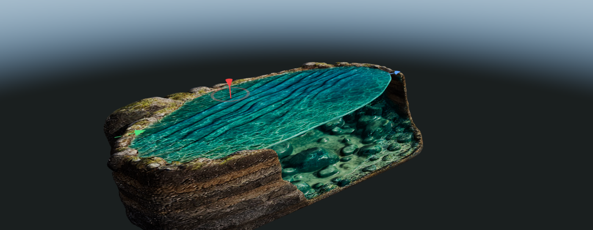

# AquaGuard AI

Цифровой двойник водоёма: 3D-модель качества воды (растворённый кислород, БПК, азот, фосфор, водоросли, мутность, температура, течения), прогноз риска гипоксии на 72 часа, сценарии и ML-модели. Программа собрана в `AquaGuard AI.exe` для Windows.



## Запуск

1. Скачайте репозиторий (Code → Download ZIP) и распакуйте.
2. Для работы советника (раздел AI Environmental Advisor) создайте рядом с `.exe` файл `.env` по образцу `.env.example` и впишите свой ключ. Без ключа всё остальное работает.
3. Запустите `AquaGuard AI.exe`. Окно программы откроется через Microsoft Edge, первый запуск занимает 15-20 секунд.

Папку `_internal` удалять и перемещать нельзя, в ней библиотеки, обученные модели (`_internal/models`) и интерфейс (`_internal/frontend/dist`).

## Язык интерфейса

По умолчанию программа на русском. Кнопка **EN / RU** в правом верхнем углу переключает язык (выбор запоминается). ИИ-советник отвечает на языке интерфейса.

Перевод встроен в собранный интерфейс скриптом `tools/i18n/patch_i18n.mjs`: словарь лежит в `tools/i18n/ru_dict.js`, правила для строк с числами и переключатель в `tools/i18n/runtime.js`. После правки словаря:

```
node tools/i18n/patch_i18n.mjs _internal/frontend/dist
```

## 3D-модель водоёма

В режиме **Обычный** (Normal) показывается 3D-модель водоёма в разрезе (`model/pond.fbx`, текстуры в `model/pond.fbm`). Модель подгоняется под размеры расчётной сетки: длина и ширина водоёма по горизонтали, максимальная глубина по вертикали (с учётом вертикального масштаба). В режимах полей (DO, BOD, Risk, Flow и др.) модель становится полупрозрачной, чтобы были видны расчётные ячейки. Галочка **Показывать модель водоёма** на вкладке 3D-симуляция скрывает модель.

Как модель встроена:

- `tools/pond/fbx2pond.mjs` переводит FBX в компактный файл `pond.bin` (индексированная сетка, поверхность воды на уровне y = 0, дно на y = -1, зеркало воды занимает квадрат [-0,5; 0,5]);
- текстуры уменьшены до 2048×2048 (`tools/pond/build`);
- `tools/pond/patch_frontend.mjs` встраивает загрузку модели в собранный интерфейс и копирует файлы в `_internal/frontend/dist/assets/pond`. Если модель не загрузится, программа покажет прежний ландшафт.

Повторить сборку модели:

```
cd tools/pond
npm install
node fbx2pond.mjs ../../model/pond.fbx build/pond.bin
node patch_frontend.mjs ../../_internal/frontend/dist build
```

`patch_frontend.mjs` применяется к исходному (непропатченному) интерфейсу.

## Структура

```
AquaGuard AI.exe        программа
_internal/              библиотеки, модели ML, интерфейс
model/                  исходная 3D-модель водоёма (FBX + текстуры)
tools/pond/             конвертация модели и встраивание в интерфейс
tools/i18n/             русский язык интерфейса
docs/figures/           графики и снимки экрана
data/test_runs/         результаты тестовых запусков программы
tools/tests/            скрипты тестов и графиков
```
